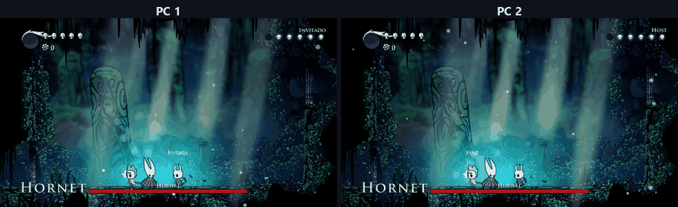

<div align="center">

# HKMultiplayer

**A co-op mod for Hollow Knight: play the whole world with your friends, on your local network or over the internet.**


[](https://ko-fi.com/yesidrobayo)

**English** · [Español](README.es.md) · [Changelog](CHANGELOG.md)



<sub>Two PCs in the same game against Hornet: both see the same thing at the same time. They lose masks to her hits, heal
with Focus (each one sees the other heal) and the partner HUD at the top right stays up to date. PC 1 wears the Rick
Knight skin (with its HUD). Hollow Knight belongs to Team Cherry.</sub>

</div>

> [!WARNING]
> **Beta.** Almost everything has been tested by playing with up to four copies of the game on the same PC, but no
> long session between real PCs over the internet has been played yet, and some parts are not fully tested (see
> [Testing status](#-testing-status)). **It may have bugs.** Back up your saves before playing and, if something goes
> wrong, open an *issue* with a screenshot and your `ModLog.txt`.

One player **hosts** a coop world and their friends **join** through **Steam** (with an invite or *Join Game*, no
port forwarding) or with the host's address and the game code: you share the world, see each other in real time and
fight the same enemies and bosses together. Up to 4 players, written from scratch on top of the Hollow Knight Modding
API.

## Contents

- [Features](#-features)
- [Testing status](#-testing-status)
- [Install](#-install)
- [How to play](#-how-to-play)
- [Game settings](#%EF%B8%8F-game-settings)
- [Technology](#-technology)
- [Development](#-development)
- [Credits](#-credits)
- [Support the project](#-support-the-project)
- [License and contributions](#-license-and-contributions)

---

## ✨ Features

- 🎮 **The whole game and its DLCs, with up to 4 players**: the story to every ending, Hidden Dreams, The Grimm Troupe,
  Lifeblood and Godmaster, with its Pantheons played together up to the Pantheon of Hallownest.
- 🌍 **Coop worlds**: up to 4 worlds of your own, saved on the host's PC, separate from your normal saves.
- 🔒 **Connection**: through **Steam** (invites and *Join Game*, no port forwarding) or by **IP** (local network or
  internet), both at once in the same game; with a game code and everything encrypted, no servers of our own. A guest
  who loses the connection gets back in on their own.
- 👥 **Players**: you see your partners in real time with their name, animations, attacks, spells and charms, and on
  the map.
- ⚔️ **Enemies and bosses**: the same on every PC (same health, same hits, same death); bosses wait until everyone is
  there.
- 🗺️ **Shared world**: progress, levers, doors, broken walls, elevators, gates, chests and NPC quests, all at once.
- ❤️ **Revive**: if you fall while a partner is still standing, you lie down and they revive you by holding Focus next
  to your body.
- 🌙 **Dreams and cutscenes**: you enter dreams together; endings and credits play at the same time and are skipped by
  vote.
- 🗣️ **NPCs for each player**: everyone hears every conversation from the start, and a character who leaves after
  talking only leaves for whoever talked to them.
- 🎨 **Skins**: CustomKnight-compatible; others see yours even if they don't have it.
- 🛠️ **Pause panel**: host settings, your partners' health, give geo, go to a partner, unstuck and reload the room.
- 🌐 **Languages**: the mod follows the game's language (Spanish, or English for any other language).
- 📦 **Installer**: a window to install, update and uninstall, which leaves the game as it was.

<details>
<summary><b>🌍 Game and connection</b></summary>

- **Coop worlds** of your own: up to 4, saved on the host's PC in
  `C:\Users\<user>\AppData\LocalLow\Team Cherry\Hollow Knight\HKMultiplayer\Mundos` (one folder per world). They are
  separate from the game's 4 save slots, which are never touched. You create, host and delete them from the menu, and
  the hosting page has a button to open that folder (for backups or to move a world to another PC).
- **Host and join** from the main menu (*Multiplayer*): the host opens a world and shares their **address**, the
  **port** (26950 by default) and the **game code** (`ABCD-EFGH` format). Buttons to copy the code and show or hide the
  IP.
- **Through Steam, no port forwarding**: hosting opens a Steam lobby. Your friends see *Join Game* in their Steam
  friends list or your game in *Multiplayer › Join a world*, and from *Pause › Multiplayer › Invite Steam friends* you
  can invite anyone. If your friend's game is closed, Steam opens it and the mod joins on its own. In *Multiplayer* you
  choose who can join through Steam: **friends**, **invited only** or **nobody**.
- **Steam and IP at the same time**: in the same game some players can join through Steam and others by IP. Anyone
  without Steam joins the host by IP, on the same network or over the internet.
- Works on a **local network and over the internet** (through Steam you don't open anything; by IP, over the internet
  the host opens the UDP port on their router, or you use a virtual LAN such as Radmin VPN, ZeroTier or Tailscale).
- **Each guest's character** is saved in the host's world: it is sent at benches, every 30 seconds and when leaving.
  When you join again you get your character back. If the host closes the game, guests' characters are collected
  first.
- **Automatic reconnection**: if a guest loses the connection to the host (not when the host closes the game), they
  go back to the main menu and try to get back in on their own, up to 12 times, and load the world again with their
  character. *Esc* in the main menu cancels it.
- **On-screen notices**: the game code, who joins and leaves, disconnections and fight waits.
- **Pause panel** (*Pause › Multiplayer*): connected players with their ping, the code, the IP and close or leave the
  game; *Game settings*, *Partners* and *Skin*.

</details>

<details>
<summary><b>🏛️ DLCs and Godhome</b></summary>

- **Hidden Dreams**: the White Defender and Grey Prince Zote, entered together with the Dream Nail.
- **The Grimm Troupe**: the Troupe's quest, Grimm and the Nightmare King, and Grimmchild for everyone.
- **Lifeblood**: the Hive and its knight, and lifeblood like in the game.
- **Godmaster**: each player enters Godhome on their own with the Dream Nail next to the Godseeker.
  - **Pantheons together**: when a player starts a Pantheon at its door, everyone in the Atrium goes in with the same
    bindings, and the group moves on to each boss together (also out of the rest room). A player who falls is revived
    next to the group in the next boss's room.
  - **The Pantheon of Hallownest ending is each player's own**: every player strikes the final blows with their own
    attack button and sees the ending cutscene when they finish theirs, without partners' knights or names on screen.
  - The Radiance's climb: the abyss rises for everyone when anyone climbs, and everyone respawns on the last platform
    passed.

</details>

<details>
<summary><b>👥 Players and partner effects</b></summary>

- You see your partners in real time, with their **name above them**, their animations and facing, with smooth movement
  (interpolation that adapts to the connection).
- **Each player has their own inventory**: health, soul, geo, masks and vessels, nail and nail arts, charms and
  notches, keys, relics, maps, essence, purchases, bench and shade.
- Their actions are seen and heard with the game's own effects:
  - **Nail slashes** (side, up, down and on walls), bigger with Mark of Pride and Longnail and colored by Fury of the
    Fallen.
  - **Nail arts**: charge, Great Slash, Dash Slash and Cyclone Slash.
  - **Spells**: Vengeful Spirit and Shade Soul, Desolate Dive and Descending Dark, Howling Wraiths and Abyss Shriek.
  - **Movement**: dash and Shade Dash, double jump, wall jump, Crystal Heart, dust when running and jumping.
  - **Healing**, **Dream Nail**, **hits taken** and the invulnerability blink.
  - **Charms and companions**: Grubberfly's Elegy, Flukenest, Defender's Crest (and its aura), Thorns of Agony,
    Dreamshield, Sharp Shadow, Glowing Womb, Weaversong and Grimmchild; the Carefree Melody shield and the Baldur
    Shell (when it goes up, blocks and breaks).
  - **Deaths**: on spikes and in acid, and a real death (in Godhome, or when everyone falls); the Shade Dash recharge
    flash.
  - **In dark rooms** the darkness opens around each partner as it does around you: you see the tunnel around them,
    not just a black screen.
  - Grass and cloth move as they walk past.
- Effects are visual only: real damage comes from each player's own hits.

</details>

<details>
<summary><b>⚔️ Enemies and bosses</b></summary>

- Each enemy is run by the PC of the **nearest** player and attacks everyone. Its health, attacks and death are the
  same on every PC; anyone's hits take its health on all of them.
- **Projectiles, spawns and summons** are created on every PC and hurt everyone (shots, crystals, lasers, Soul Master
  orbs, Mawlek balls, Hornet's needle, the Collector's jars, the False Knight's barrels...).
- **Enemy effects and sounds**, hit effects, boss music, the **boss name** when it wakes up and a **boss health bar**
  with its name in the game's language.
- **Boss parts and traps** match on every PC: the Crystal Guardian's laser and ceiling turrets, Hornet's needle, the
  False Knight's head...
- **Wave arenas**: Mantis Lords, the Colosseum of Fools (Bronze, Silver and Gold), Watcher Knights...
- **Boss fights wait until everyone in the room is there**, with a notice saying who is missing; meanwhile the boss
  is invulnerable. **Dialogues before a fight** are shown to everyone, and each waits for the others to finish reading.
- **Boss introductions** keep every knight still and give control back at the same time.
- **Boss health bars** only for the boss that is fighting; the Vengefly King and Gruz Mother count as bosses.
- If a boss moves to another PC mid-fight (because the other player got closer), it carries on where it was.
- Dead enemies stay dead when you come back to the room, until you rest at a bench (as in the game).

</details>

<details>
<summary><b>🗺️ Shared world</b></summary>

- **Live shared progress**: defeated bosses, doors, levers, broken walls, visited rooms and maps.
- **Abilities are per player** (movement abilities, spells, Dream Nail): each player gets their own and sees the
  pickup scene. Characters saved with an earlier version keep the abilities they already had.
- **Loot lands in the same place** on every PC: geo from enemies, geo rocks and chests.
- **Stag travel together** (host option): when one player picks a destination, partners standing near them at that
  station ride along.
- **Shared benches**: up to 4 players sit side by side on the same bench, never inside a wall.
- **Version notices**: the main menu tells you when a new version is out (and *Multiplayer* offers to download it)
  or when the mod was just updated (with what's new). It is one request to GitHub's public release list when the game
  starts; turn it off in *Multiplayer › Check for updates*.
- **New guests see the opening cinematic** (skippable) before joining the host's world.
- **Room objects**: levers, switches, doors, breakable walls and floors, geo rocks, breakables, grass, vines, grub jars,
  stalactites, signs and props with their own logic.
- **Elevators**: run by whoever uses them; the other player sees them move the same way.
- **One-way battle gates**: if they close with one player inside, the other can come in to help but not leave.
- **Chests**: if one player opens one, the other sees it open; what drops is for each player.
- **Individual items** (shiny items, mask shards, vessel fragments, dream orbs): what one player picks up doesn't
  disappear for the other.
- **NPC quests**: Mr. Mushroom, Quirrel, Bretta, Zote, Tiso, Myla, Hornet, the Nailsmith, the Grimm Troupe... The quest
  never advances twice.
- **Conversations for each player**: what a character already told one player isn't skipped for the next (Zote no
  longer asks the second one why they keep bothering him), and a character who leaves or moves after talking (Zote,
  Quirrel, Cloth, Tiso...) only does it for whoever talked to them.
- **Animated hazards in sync** (the White Palace and Path of Pain saws and spikes).
- Whoever enters a room finds it as it is: what's activated, what's broken, dead enemies and fights in progress.

</details>

<details>
<summary><b>❤️ Co-op features</b></summary>

- **Revive**: if you die while a partner is standing, you don't die, you go down. Your body lies on the floor with
  "† Name" and your camera follows your partner. They get a notice and an arrow to your body; next to it, **holding
  Focus for 2 s** and spending 33 soul revives you with 1 mask. If your partner sits at a bench, downed players revive
  next to them with full health. If everyone goes down, each player dies normally. If you die where nobody could
  stand next to you (in the air over a pit, on spikes or in acid), your body lies on the last safe ground, where the
  game respawns you after a hazard.
- **Shared shades**: everyone sees their partner's shade and can kill it; its owner gets their geo and soul back even
  in another room.
- **Partner HUD** at the top right (name, masks, soul and where they are), their masks above their head when their
  health changes, and **arrows** at the edge of the screen pointing to partners and bodies.
- **Partners on the map**: with the map open, each partner shows up as a compass in their own color with their name
  where they are, also inside shops (when both of you wear the Wayward Compass), and red on their body if they are
  down.
- Optional **enemy health bars** above each damaged enemy.
- **Shared cutscenes**: endings, credits and Mr. Mushroom play at the same time even in different rooms; they are
  skipped when everyone votes ("Waiting for X to skip 1/2"). The Pantheon of Hallownest ending is the exception: each
  player sees it when they finish theirs.
- **Shared dreams**: if one player enters a dream with the Dream Nail, partners in the same room enter too. When you
  win, everyone leaves; whoever falls or dies leaves alone. Dream bosses, the Nightmare King and the Radiance.
- **Grimmchild**: if one player gets it, the other does too.
- **Skins** compatible with CustomKnight (*Pause › Multiplayer › Skin*): body, spells and effects; sent through the
  mod's own network in the background without delaying hits (the first time; then they're kept in a cache and load
  instantly), and you can turn off seeing other players' skins.
- **Partners** (*Pause › Multiplayer › Partners*): each partner's health, soul and location, **give geo**, **go to**
  them (you appear next to them, even in another room), **unstuck** (back to the last safe ground) and **reload the
  room**.

</details>

---

## 🧪 Testing status

Testing uses up to four copies of the game on the same PC, with the mod's test mode and automated routes that walk
through the world checking that every player sees the same thing.

✅ **Tested by playing:**

- Connection, coop worlds and guests' characters.
- Enemies in every area.
- Bosses: Gruz Mother, False Knight (also on a bad connection), Hornet, Brooding Mawlek, Soul Master, Dung Defender,
  Nosk, Broken Vessel, Crystal Guardian and Enraged Guardian, Mantis Lords, Uumuu, The Collector, Traitor Lord,
  Watcher Knights, Flukemarm, Vengefly King, Grimm, Soul Tyrant, Hollow Knight, Pure Vessel, the Radiance and the
  Absolute Radiance.
- Colosseum of Fools: Bronze, Silver and Gold.
- Dreams: Failed Champion, Lost Kin, Soul Tyrant, White Defender, Grey Prince Zote and the Nightmare King.
- Revive (also the body on the last safe ground, over spikes and acid), shades, partner HUD, partners on the map
  (also inside shops), host settings, cutscenes, skins, go to a partner, NPC quests and conversations, vine platforms,
  the Menderbug, the mod in English and automatic reconnection (also cancelling it and giving up).
- Install, update and uninstall.
- 0.26.0: the whole mod was reviewed against the game's code. The 172 issues found were fixed or reviewed, and most
  were checked in the game; the testing found and fixed 16 more.
- 0.29.0: the whole story with 4 players (four copies of the game): every boss with real fights, the dreams and the
  dream warriors, the three Dreamers, the Black Egg, the Hollow Knight (both endings) and the Radiance, the Grimm
  Troupe, Grey Prince Zote, the Colosseum of Fools (Bronze, Zote included), Zote and Cloth, and the Pantheon of the
  Master from start to finish.
- 0.30.0: every boss fight again with 4 players, one at a time, and the Pantheon of Hallownest to its ending, which
  each player finishes on their own PC. Then the 16 automated routes with 4 players and a fresh world.
- 0.31.0: the Steam connection with a simulated Steam, where each copy of the game acts as a different account:
  joining through the lobby and by invite, private lobbies, Steam and IP guests in the same game, and the test routes
  with two players joining through Steam and one by IP.

⚠️ **Partially tested:**

- Hive Knight and Massive Moss Charger: they die on every PC, but their attacks still need checking.

❓ **Not tested yet:**

- A session between real PCs over the internet.
- Real Steam between two accounts: the part that talks to Steam (creating the lobby, inviting, joining and connecting
  through its relays) has only been tested with the simulated Steam.
- Playing with 3 or 4 players: the cases that only happen with three or more were fixed in 0.28.0 and tested with four
  copies of the game on one PC, but not yet between real PCs.

Known limitations:

- A boss attacks the player whose PC runs it, which is the nearest one; that's what makes it attack everyone. It
  changes PC at most every 8 s and, since 0.27.0, only between two attacks (or after 4 s without a pause).
- Your partner and the enemies run by another PC are drawn a few hundredths of a second in the past so they move
  smoothly. Very fast falling objects show it a little.

The full list (in Spanish) is in [docs/arquitectura.md](docs/arquitectura.md#pendientes).

---

## 📦 Install

> [!NOTE]
> You need **Hollow Knight 1.5.12620 on Windows** (the current Steam version; GOG works too). All players must have
> **the same version** of HKMultiplayer. Mac and Linux are not supported, and the Xbox/Game Pass version is not tested.

1. Download `HKMultiplayer-<version>.zip` from the [*Releases*](../../releases) page.
2. Close the game, **extract the whole zip** and double-click **`HKMultiplayer Setup.exe`**.
3. In the window that opens, check the game folder and click **Install**.
4. Open Hollow Knight from Steam: **Multiplayer** appears in the main menu.

Windows may warn you when opening a file downloaded from the internet: click *Run* (or *More info › Run anyway*). The
installer is open source: its code is in [`tools/installer/launcher`](tools/installer/launcher). If you'd rather not use
it, install by hand (below).

<details>
<summary><b>What the installer does</b></summary>

- Finds the game folder (Steam, its libraries and the usual paths); if there are several, you pick one from the list,
  and if none is found, you use *Browse…*.
- Checks that the game is version 1.5.12620 and closed, and that the package is complete (`SHA256SUMS.txt`).
- Saves a copy of every file it changes in `<game>\HKMultiplayer-backup` and records everything in `manifest.txt`.
- Removes the old **HollowKnightCoop** mod if present and moves other mods to `Mods\Disabled`, telling you which ones
  before installing (mods built for another
  Modding API version can break the game).
- Copies the Modding API and the mod, and verifies the copy. Installing a new version on top is an update.
- When it opens it checks GitHub: if there is a newer version than the package, a notice at the top offers to download
  it. **What's new** (bottom right) shows what that version brings, or this package's one if there is none newer.
- **Uninstall** undoes everything in reverse: the game is left as it was. Your coop worlds, saves and skins are not
  touched.
- Don't mix it with Lumafly or Scarab on the same folder: their "vanilla" switch moves the same files, and uninstalling
  may then not leave the game exactly as it was (Steam's *Verify integrity* fixes it).
- It also works from the console: `start /wait "" "HKMultiplayer Setup.exe" /install "D:\Games\Hollow Knight"` (or
  `/uninstall`).

</details>

Rather not use the installer? The package's `README.txt` (English) and `LEEME.txt` (Spanish) explain the **manual
installation**, how to open the port and what to do if something fails.

---

## 🎮 How to play

1. **Host**: main menu › *Multiplayer* › *Host a world* › *New world* (or pick one) › *Create and host*. With Steam,
   your friends can already join; to invite someone: *Pause › Multiplayer › Invite Steam friends*. By IP, give your
   friends your **IP**, the **port** (26950) and the **code** shown on screen (also in *Pause › Multiplayer*).
2. **Guest through Steam**: accept the invite or click *Join Game* in your Steam friends list (also *Multiplayer ›
   Join a world › Join…*). If you're playing your normal game, go back to the main menu and you'll join on your own.
3. **Guest by IP**: main menu › *Multiplayer* › *Join a world*, with the address, the port and the code.
4. **Over the internet by IP**: the host opens **UDP port 26950** on their router (or you use Radmin VPN, ZeroTier or
   Tailscale). Through Steam or on the same home network you don't need to open anything.

---

## ⚙️ Game settings

The host sets them in *Pause › Multiplayer › Game settings*; they are saved with each world and guests see them right
away without being able to change them.

| Setting | Values | Default |
|---|---|---|
| Boss health | 1× · 1.25× · 1.5× · 2× · 2.5× · 3× | 1.5× |
| Enemy health | 1× · 1.25× · 1.5× · 2× | 1× |
| Extra health only with a partner in the room | Yes · No | Yes |
| Damage taken | 0.5× · 1× · 1.5× · 2× | 1× |
| Revive | Yes · No | Yes |
| Time to revive | 1 · 2 · 3 · 5 s | 2 s |
| Soul to revive | 0 · 33 · 66 · 99 | 33 |
| Masks on revive | 1 · 2 · 3 · All | 1 |
| Invulnerable after revive | 1 · 2 · 3 · 5 s | 2 s |
| Revive at a partner's bench | Yes · No | Yes |
| Names · Partner health · Arrows to partners · Partners on the map · Notices · Boss bar | Yes · No | Yes |
| Enemy bars | Yes · No | No |
| Gift geo · Allow going to a partner | Yes · No | Yes |
| Skip cutscenes | Vote · Anyone | Vote |
| Ride the stag together | Yes · No | Yes |

The boss and enemy health is the extra health with one partner: each additional partner standing in the room adds the
same again (1.5× is 2× with three players and 2.5× with four). Bosses that get stunned after a number of hits (Hornet,
Broken Vessel, Grimm...) need as many times more hits as there are players in the room, so they don't spend the fight
stunned when several players hit them at once.

---

## 🔧 Technology

| Component | Used for |
|---|---|
| **Hollow Knight Modding API** (Unity 6) | Loading the mod and hooking the game. A modified version for 1.5.12620, included in [`modding-api/`](modding-api). |
| **MonoMod** | Hooks into the game's code (`MMHOOK_*.dll`, `MonoMod.RuntimeDetour`). |
| **PlayMaker** | Reading and driving the game's state machines: enemies, bosses, elevators, gates, arenas, dialogues. |
| **BouncyCastle** | Encryption: X25519, HKDF-SHA256 with the game code and ChaCha20-Poly1305 on every packet. |
| **Steamworks.NET** (the one the game ships) | Steam lobbies, invites and account-to-account connections (SteamNetworkingMessages, direct or through Valve's relays) to play without port forwarding. |
| **Unity UI** | Menus in the game's style, notices and the partner HUD (with the game's own HUD sprites). |

- **Custom networking over UDP or Steam**: reliable and unreliable channels, chunked large transfers (the world when joining),
  heartbeat and clean disconnects, with no per-packet allocations to avoid stutters.
- **Security**: only people who know the game code can join; everything is encrypted and authenticated, also through
  Steam (Steam only carries the packets). Through Steam, connections are only accepted from friends, lobby members or
  the host you're joining.
- **No servers of our own**: by IP players connect directly to each other; through Steam, Steam carries the traffic.

---

## 💻 Development

> [!NOTE]
> Code identifiers are in English; code comments, logs and the design notes in `docs/` are in Spanish.

<details>
<summary><b>Repository layout</b></summary>

| Folder | Contents |
|---|---|
| `src/HKMultiplayer/Net/` | UDP transport, channels, encryption and game codes (no Unity, tested outside the game). |
| `src/HKMultiplayer/Session/` | Session: hosting and joining, players, rooms and each room's owner, message routing. |
| `src/HKMultiplayer/Game/Players/` | Player state, interpolation, partner avatars and their effects. |
| `src/HKMultiplayer/Game/World/` | Coop worlds, saving, guests' characters, shared progress and NPC quests. |
| `src/HKMultiplayer/Game/Features/` | Co-op features: player status, host settings, revive, shades, HUD, partners on the map, bars, geo gifts, going to a partner, dreams, cutscenes, skins. |
| `src/HKMultiplayer/Game/Scene/` | Room objects, breakables, elevators and gates, battle controllers, enemies and bosses, animated hazards. |
| `src/HKMultiplayer/UI/` | Menus, notices, language and the co-op HUD canvas. |
| `src/HKMultiplayer/Testing/` | Test mode: file-driven commands to test with several copies of the game. |
| `modding-api/` | Modding API source (hk-modding/api, MIT) for Unity 6: the `hk-beta-branch-unity-6-update` branch of `SFGrenade/api` (PR hk-modding/api#164, commit `468f579`) with our own changes. No game files. |
| `tests/` | Transport tests outside the game and co-op test routes (`tests/routes/`). |
| `tools/` | PC setup (`setup-dev.sh`), build and install (`test-cycle.sh`), multi-copy tests, automated routes, package and installer. |
| `docs/` | [Architecture](docs/arquitectura.md) (Spanish): design, decisions, testing and pending work. |
| `lib/`, `vendor/`, `test-instances/` | *(local only, not committed)* Game and Modding API DLLs, and game copies for testing. |
| `decomp/` | *(local only, not committed)* The game's code decompiled by `tools/decompile.sh`, for reference. |

The game's DLLs belong to Team Cherry and are not in the repository: they are taken from your installed game.

</details>

### Building (also on another PC)

You need Hollow Knight 1.5.12620 installed, the .NET SDK (`dotnet`) and Git Bash.

```bash
git clone https://github.com/Yesid-Robayo/HKMultiplayerMOD.git
cd HKMultiplayerMOD
bash tools/setup-dev.sh "C:/Program Files (x86)/Steam/steamapps/common/Hollow Knight"   # once
bash tools/test-cycle.sh            # builds the mod and installs it in the test copies (--game: also in the game)
dotnet run --project tests/NetTests # transport tests
bash tools/package.sh               # player package: out/package/HKMultiplayer-<version>.zip
```

`setup-dev.sh` copies the game's **unmodified** `Managed` folder to `modding-api/Vanilla`, builds the Modding API and
fills `lib/` and `vendor/`. If the game already has the Modding API, it uses the originals saved by the installer
(`HKMultiplayer-backup`); if there are none, it asks you to verify the game files in Steam. To change the Modding API,
edit `modding-api/` and run it again.

`bash tools/decompile.sh` decompiles the game's code into `decomp/` to see how it does something (needs `ilspycmd`).
PlayMaker FSMs are not in there; see [Código del juego](docs/arquitectura.md#código-del-juego) (Spanish).

### Testing

- **Up to four players on one PC**: `tools/mp-test-lib.sh` and `tools/routes/lib.sh` (`setup_group`) open copies of
  the game (`test-instances/`) in test mode and send them commands through a file: host and join, go to a room, move, attack, screenshots from all of
  them at once, enemy and object state, simulated bad connection (`netsim`)... Commands are listed in
  [docs/arquitectura.md](docs/arquitectura.md#pruebas).
- **Automated routes**: `bash tools/run-routes.sh` walks through the game area by area with a host and guests and
  checks in every room that everyone sees the same thing (`--players 4` plays them with four, `--pairs 3` splits the
  areas between 3 pairs and `--steam` has the guests join through a simulated Steam, where each copy is an account). Format:
  [tests/routes/README.md](tests/routes/README.md).
- **Installer**: `bash tools/manual-tests/installer-test.sh <zip>` installs, launches, uninstalls and compares on clean
  copies, without touching the Steam game.

---

## 🙏 Credits

- **[Hollow Knight](https://www.hollowknight.com/)** is by **Team Cherry**. This mod is an unofficial fan project and is
  not affiliated with Team Cherry. The repository contains no game files; like the official Modding API releases, the
  player package includes the game's `Assembly-CSharp.dll` and `TeamCherry.Localization.dll` already patched by the
  Modding API.
- **[Hollow Knight Modding API](https://github.com/hk-modding/api)** (MIT), with the Unity 6 port by
  [SFGrenade](https://github.com/SFGrenade/api).
- **[MonoMod](https://github.com/MonoMod/MonoMod)**, **[Mono.Cecil](https://github.com/jbevain/cecil)**,
  **[unity-scene-repacker](https://github.com/jakobhellermann/unity-scene-repacker)**,
  **[BouncyCastle](https://www.bouncycastle.org/)** and **[Newtonsoft.Json](https://www.newtonsoft.com/json)**, all MIT
  (full notices in [THIRD_PARTY_NOTICES.txt](THIRD_PARTY_NOTICES.txt)).
- Skins compatible with **CustomKnight**.

---

## ☕ Support the project

HKMultiplayer is free and made by a single person. If you like it and want to support it, you can buy me a coffee on
**[Ko-fi](https://ko-fi.com/yesidrobayo)**. It's not required: reporting bugs with your `ModLog.txt` helps a lot too.

## 📄 License and contributions

- HKMultiplayer's code is licensed under the **[MIT License](LICENSE)**. It is provided **as is, without any
  warranty**: use it at your own risk and back up your saves. The Modding API in [`modding-api/`](modding-api) keeps its
  own MIT license.
- **Pull requests are not accepted** (they are closed automatically). Bugs and ideas go in an *issue*; see
  [CONTRIBUTING.md](CONTRIBUTING.md).
- Security problems are reported privately: [SECURITY.md](SECURITY.md).
